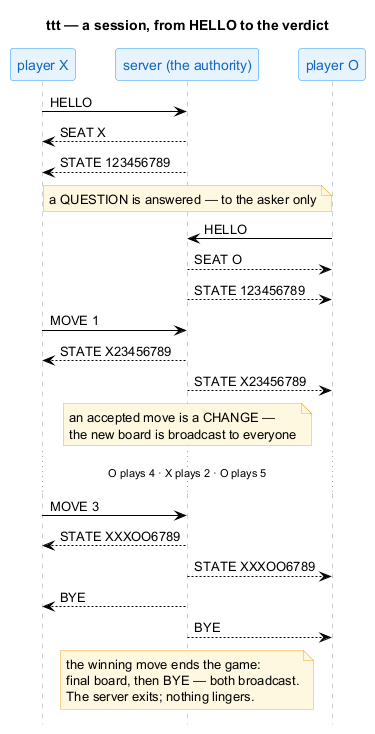
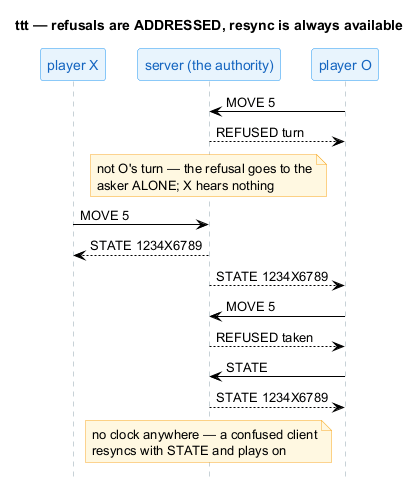

# ttt protocol — v3.0

Line-based ASCII over TCP: one frame per line, `\n`-terminated.
No seat travels on the wire — **the socket is the address**.

## Frames

Client → server (requests):

| Frame | Meaning |
|---|---|
| `HELLO` | sit down: asks for your seat and the current board |
| `MOVE <n>` | play cell *n* (1–9) |
| `STATE` | resync: ask for the current board (no move played) |
| `BYE` | leave |

Server → client (updates):

| Frame | Meaning |
|---|---|
| `SEAT X` · `SEAT O` | your seat — the reply to your `HELLO` |
| `STATE <cells>` | the board: 9 chars, cells 1–9 in order — `X`, `O`, or the cell's own digit if free |
| `REFUSED <why>` | your move was declined: `turn` · `range` · `taken` · `over` |
| `BYE` | the session is over |

A fresh board is `STATE 123456789`. Whose turn it is travels nowhere:
it is **derived from the counts** (X starts, so equal counts = X's turn).

## Behaviour

1. **Seats are assigned, never claimed** — by arrival: the first
   connection is X, the second is O, and the listener then closes
   (a third connection is refused).
2. **The reply rule** — the authority answers *every* request:
   a **question** gets its answer addressed to the asker alone
   (`HELLO` → `SEAT` + board · `STATE` → board · a `MOVE` out of turn →
   `REFUSED turn` · a `MOVE` against the rules → `REFUSED range|taken|over`);
   a **change** is broadcast to everyone (an accepted `MOVE` → the new
   board · the end of the game or a departure → `BYE`).
3. **Refusals are private**: the other seat never hears about your
   mistakes.
4. **Malformed lines are ignored** — the reader is tolerant; the
   protocol has no error frame.
5. **No clock anywhere**: nothing times out; a confused client resyncs
   with `STATE` and plays on.
6. **The end is a broadcast**: the final board, then `BYE`, to everyone
   — after which the server exits.

Rules 2, 3 and 6 live in `server/src/controller.rs` (a pure state
machine, tested synchronously); rules 1 and 4 in `server/src/net.rs`
(seating by arrival, the tolerant reader); rule 5 is the absence of
any clock in the code. All of them are observed on the wire by
`e2e.sh` — including through plain `nc`, the zero-code client.
