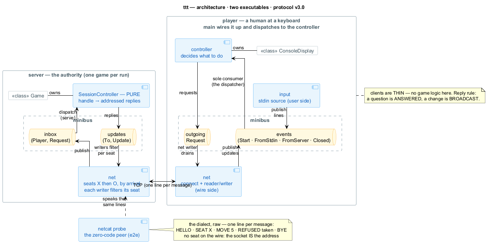
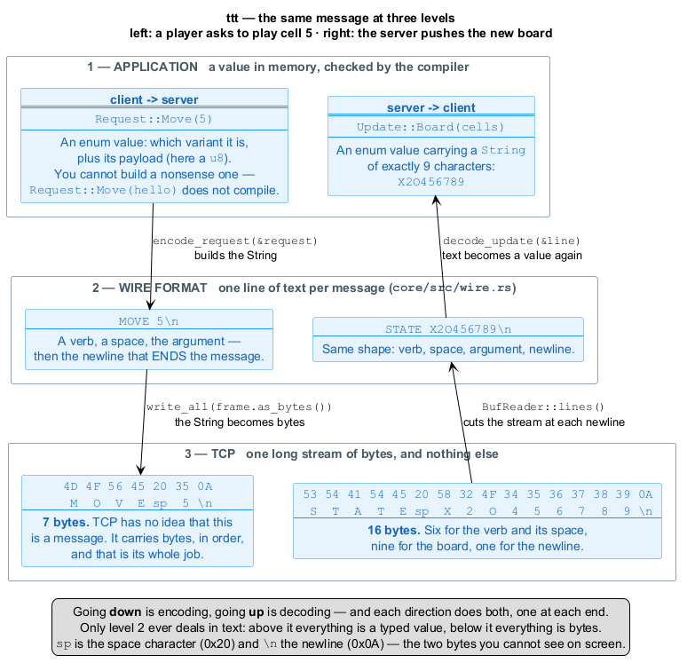
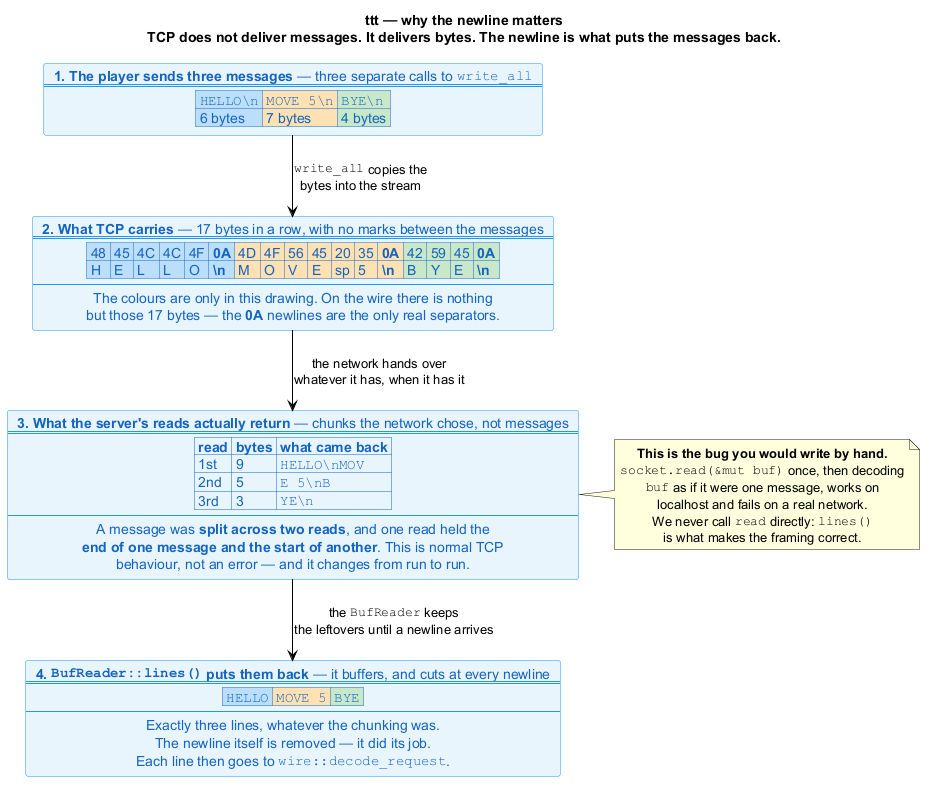
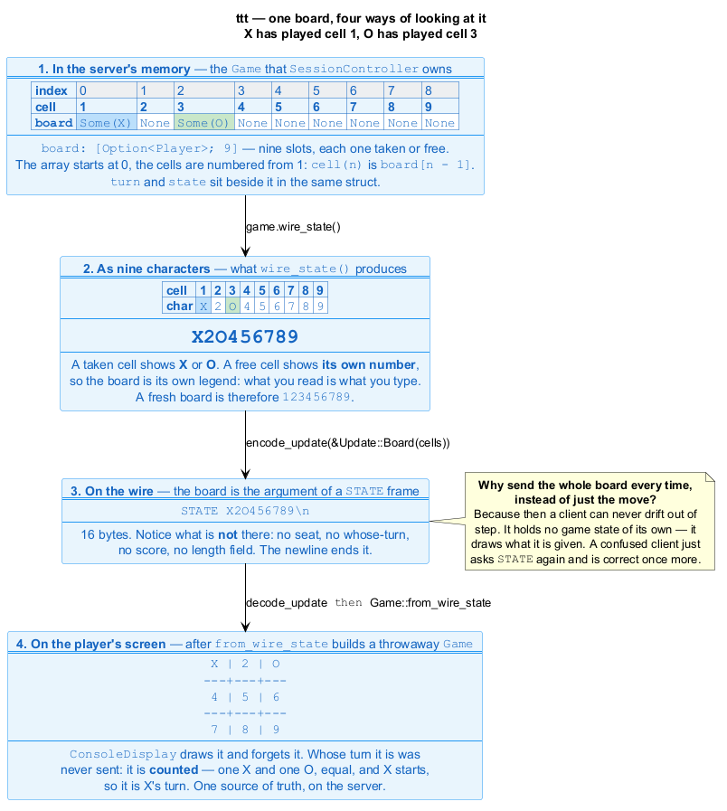
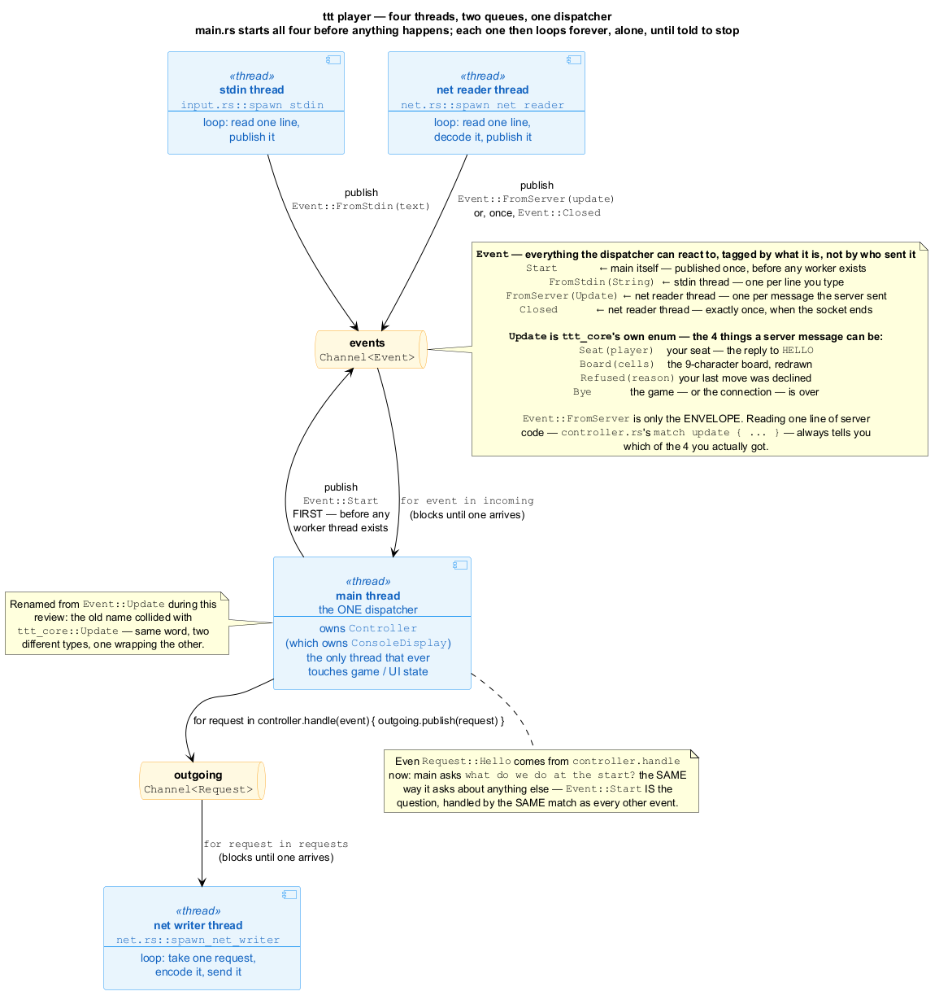
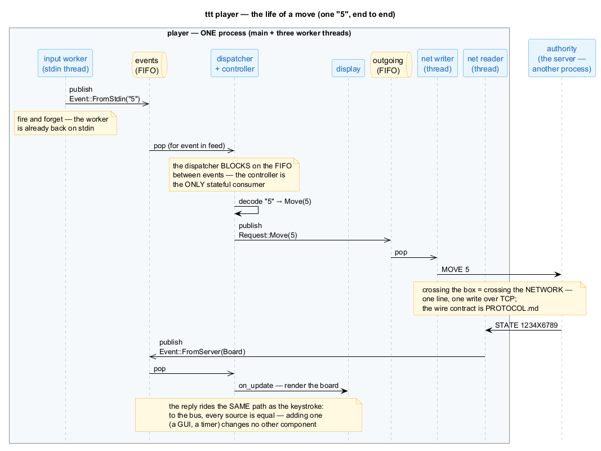
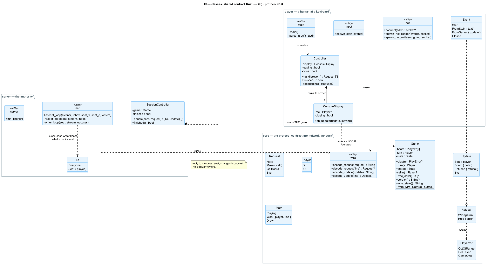

# ttt

Tic-tac-toe over TCP — the worked example of the course architecture:
three crates, one protocol, a bus.



- **core** — the contract: the game rules (`Game`), the vocabulary
  (`Request` / `Update`), and the text format they travel in.
  No network, no bus; fully testable on its own.
- **server** — the authority: seats the first two connections (X then O,
  a third is refused), owns THE `Game`, and answers every request —
  a question is answered, a change is broadcast. Legality lives here,
  nowhere else.
- **player** — a thin client: workers translate stdin and the socket
  onto the `events` bus, the controller decodes lines into requests,
  and the display renders each pushed board. The terminal is the
  replica — each board is drawn and forgotten, never played on here.

The bus is the `minibus` you implemented in `../04-minibus`, referenced by
path — this project builds on the same crate, not a copy of it.

## Try it

```
just check                    # build + tests + lint + e2e
just server 4747              # terminal 1
just player 127.0.0.1:4747    # terminals 2 and 3
```

The protocol is line-based ASCII, so `nc 127.0.0.1 4747` is a valid
player: `HELLO`, then `MOVE 5` · `STATE` · `BYE`. The full contract —
frames and behaviour, with sequence diagrams — is in
[PROTOCOL.md](PROTOCOL.md).

## The data

The same message, at the three levels it exists at — an enum in memory,
a line of text, and the bytes TCP actually carries:



TCP delivers **bytes, not messages**. What you send in three writes can
arrive in two reads, or five — a message split down the middle, or two
messages in one chunk. The newline is what puts them back together, and
`BufReader::lines()` is what does it:



And one board, from the array the server owns to the grid you see:



## The player's threads

The player runs four threads and touches two queues — this is the part
that is hardest to hold in your head from the source alone, because the
threads are declared in three different files. One picture of all four,
plus what each `Event` variant means and who publishes it:



The one rule that makes it hang together: **only the main thread ever
calls `Controller::handle`.** The other three only move bytes — none of
them knows what a "turn" or a "refusal" is.

## The life of a move

One keystroke, end to end: the bus hops, the blocking dispatcher, the
network crossing — and the reply riding the same path as the keystroke:



## Classes


